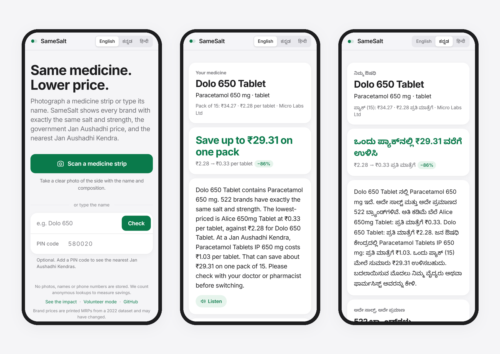
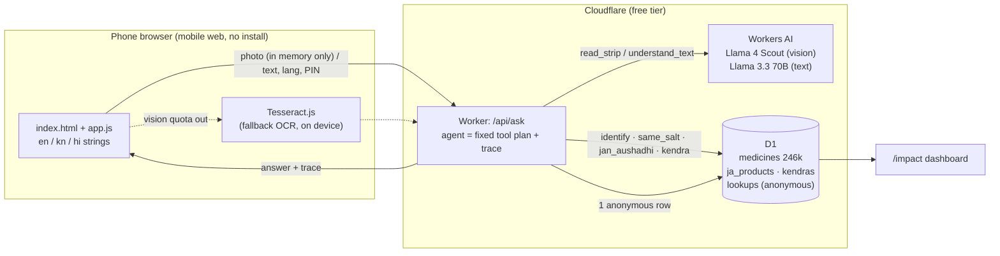

# SameSalt — same medicine, lower price

**Photograph a medicine strip (or type its name) in English, ಕನ್ನಡ or हिन्दी. SameSalt shows every brand with exactly the same salt, strength and form, ranked by price, the Jan Aushadhi generic and its government MRP, and the nearest Jan Aushadhi Kendra. Every lookup is counted anonymously on a public impact page.**

**Live app:** https://samesalt-agent.samesalt-worker.workers.dev · **Impact dashboard:** https://samesalt-agent.samesalt-worker.workers.dev/impact · **Volunteer mode + QR:** https://samesalt-agent.samesalt-worker.workers.dev/volunteer

Entry for **Code for a Billion — Bharat Agentic-AI Hackathon 2026**, Health track ([submission #24](https://github.com/karlmehta/code-for-a-billion/issues/24)). Built in **AgentFoundry** ([how](#how-agentfoundry-was-used)). Field pilot planned with **Uttara Karnataka Sneha Loka (UKSL)**, North Karnataka, from late October 2026 ([pilot guide](docs/PILOT.md)).



---

## The problem

- **Indians pay for health care out of their own pockets.** Out-of-pocket spending was **39.4% of India's total health expenditure in 2021-22** (total health expenditure ₹9,04,461 crore), per the Government's National Health Accounts estimates ([PIB, Oct 2024](https://static.pib.gov.in/WriteReadData/specificdocs/documents/2024/oct/doc2024104408201.pdf)).
- **Medicines are the biggest part of that bill, and they push people into poverty.** Purchase of medicines is the single largest component of household out-of-pocket payments; in 2011-12 out-of-pocket spending on medicines alone pushed **3.09% of India's population, about 38 million people, into poverty** (Selvaraj, Farooqui & Karan, *BMJ Open* 2018;8:e018020, [PMC5988077](https://pmc.ncbi.nlm.nih.gov/articles/PMC5988077)).
- **The same molecule is sold under hundreds of brands at very different prices.** In the 246,068-product dataset SameSalt uses, paracetamol 650 mg tablets alone come in **522 distinct brands**, from **₹0.33 to ₹23.80 per tablet**; Dolo 650 is ₹2.28 per tablet. Nothing at the counter tells the patient that.
- **The government generic exists but people don't find it.** Jan Aushadhi (PMBJP) medicines are priced **50-80% below comparable brands**; over **18,000 Kendras** sell **2,110 medicines**, and by June 2025 Jan Aushadhi sales had saved citizens an estimated **₹38,000 crore** ([PIB backgrounder, 7 Mar 2026](https://static.pib.gov.in/WriteReadData/specificdocs/documents/2026/mar/doc202637814101.pdf)). The patient still has to know the generic name, that it is *exactly* the same composition, and where the nearest Kendra is.

The government's own Jan Aushadhi Sugam app searches generics by name. SameSalt starts from what the patient actually holds (a strip, often in a language and script they don't read), compares against **every** branded equivalent too, answers in Kannada or Hindi, and is built to be used **by NGO volunteers with patients**, with impact measured from day one.

## What it does

1. **Scan or type.** A photo of the strip is read by a vision model (brand, salts, strengths, form, release type). Typed names work in any script (`ಡೋಲೋ 650`, `पैन 40 टैबलेट`, `dolo650`).
2. **Exact-composition match.** Two products match **only** if salts, strengths, dosage form and release type are all identical (`amoxicillin:500mg+clavulanic acid:125mg|tablet`). 650 mg never matches 500 mg; SR never matches plain; paracetamol + caffeine never matches paracetamol.
3. **Ranked by price per tablet**, with "save up to ₹X on one pack".
4. **Jan Aushadhi generic + official MRP** for the same key, from the official PMBJP list.
5. **Nearest Jan Aushadhi Kendra** by PIN code or location, from the official Kendra list.
6. **Answer in English, Kannada or Hindi**, with a Listen button (device text-to-speech).
7. **Safety:** same salt + strength + form only; every answer ends with "check with your doctor or pharmacist before switching"; **never** dosage advice; narrow-therapeutic-index medicines (warfarin, thyroxine, antiepileptics, transplant drugs, lithium, digoxin…) get a red warning and **no** cheaper list.
8. **Show to the pharmacist** card, **"did you switch?"** tap, and **volunteer mode** with a printable QR page for NGO volunteers.

## Architecture



The agent is a **fixed, auditable tool plan** — `read_strip → identify_medicine → find_same_salt → jan_aushadhi_match → nearest_kendra → compose_answer` — not a free-running LLM. Models are used only where they are needed (reading a photo; understanding free text in any script). Every price, match and safety line comes from deterministic tools over published data, and the answer is composed from templates (`public/strings.js`), so a model can never invent a price or drop the safety line. Every step is returned to the UI ("How SameSalt worked this out") and recorded as an AgentFoundry run.

| Path | What |
|---|---|
| `worker/src/agent.js` | tool plan, trace, safety (NTI) handling |
| `worker/src/tools.js` | `identify_medicine`, `find_same_salt`, `jan_aushadhi_match`, `nearest_kendra`, savings |
| `worker/src/normalize.js` | canonical composition key — a 1:1 port of SameSalt's Python pipeline, byte-identical on a 2,000-row sample of the database |
| `worker/src/vision.js` | `read_strip` (vision, two-model fallback) and `understand_text`; prompts come from `.codenow/agent-studio/prompts/` |
| `worker/src/index.js` | API, anonymous impact log, `/api/impact` |
| `public/` | the web app, `/impact`, `/volunteer` |
| `data/` | builds D1 seed SQL from SameSalt's database and the official PMBJP lists |
| `.codenow/` | AgentFoundry project: agent manifest, prompts, evals + results, run traces |
| `tools/demo-video/` | records the live app on a phone viewport (flagged as test traffic) and composes the captioned demo video |

**Cost: ₹0.** Cloudflare Workers + D1 + Workers AI free allocations; no paid keys. If the daily free vision quota runs out, the phone reads the photo itself with Tesseract.js and the same tools run on that text.

## Accuracy (tests and evals)

- **Unit tests:** `node --import ./test/register-md.mjs --test test/normalize.test.mjs test/tools.test.mjs` → **26/26 pass** — strength normalisation (650 mg = 0.65 g = 650 MG), multi-salt order and spelling (Amoxycillin/Amoxicillin), SR vs plain, combinations vs single salts, NTI handling, PIN/location Kendra search, savings, the three-language answer, and the whole agent with a stubbed vision model. `python test/test_build_ja.py` checks the PMBJP-name parser.
- **Key parity:** the JavaScript key builder reproduces the Python pipeline's key on **2,000/2,000** randomly sampled database rows.
- **End-to-end evals against the live deployment** (`node evals/run_evals.mjs`, results in [`evals/RESULTS.md`](evals/RESULTS.md)): **23/23** — 15 strip photos, 3 deliberately hard photos (heavy blur, cropped, a brand not in the database, which is matched by its printed composition) and 5 typed queries including Kannada and Hindi script. Median latency ≈ 1.7-2.7 s per lookup. One earlier run had a transient failure on the very first request after a deploy; the app and the eval runner now retry once.
- **Prompt eval in AgentFoundry:** the `understand_text` prompt passes **12/12** cases (Kannada/Hindi/Hinglish brands, "no medicine" text, prompt injection, JSON-only) on AF's served model.
- **Honest limits:** all eval photos are **synthetic renders** (`evals/render_strips.py`), cleaner than real foil strips under shop lighting; real-world accuracy will be lower and will be measured in the pilot. Brand prices are **printed MRPs from a November 2022 dataset** — they show relative price differences well, but today's shelf price may differ.

## Data sources

| Data | Source | Date |
|---|---|---|
| 246,068 brands: name, manufacturer, composition, printed MRP, pack | [A-Z Medicine Dataset of India](https://www.kaggle.com/datasets/shudhanshusingh/az-medicine-dataset-of-india) (Shudhanshu Singh, CC BY-SA 4.0), normalised by [SameSalt's pipeline](https://github.com/darshanrajagoli/samesalt/tree/main/pipeline) | Nov 2022 |
| Jan Aushadhi product basket + MRPs | PMBI / Dept. of Pharmaceuticals: [janaushadhi.gov.in — product MRP list](https://janaushadhi.gov.in/product-portfolio/product-mrp-list) | **pending load** — see below |
| Jan Aushadhi Kendra list | PMBI: [janaushadhi.gov.in — locate Kendra](https://janaushadhi.gov.in/locate-kendra) | **pending load** — see below |

**Status of the Jan Aushadhi data (honest):** the loader (`data/build_ja.py`, with tests) and the app paths are done and tested with fixtures, but the official lists are served from `janaushadhi.gov.in:8443`, a port that the network this was built on blocks. Until the lists are loaded, the app says "Jan Aushadhi prices are not loaded yet" instead of showing anything made up. Loading them is two commands once the files are downloaded (below), and the app shows the list date next to every Jan Aushadhi price.

## Privacy

- Photos are sent to the Worker, read in memory, and **never stored**.
- The impact log stores, per lookup: time, matched medicine, per-unit prices (scanned, cheapest same-salt, Jan Aushadhi), the saving for one pack, language, the **first 3 digits** of the PIN code if typed, self/volunteer mode, a random per-browser token (not derived from the device) for counting unique users, and the optional "did you switch?" answer.
- **No names, phone numbers, IP addresses, user agents or precise locations.** "Use my location" is rounded to ~1 km on the phone, used for that lookup only, and not stored.
- Test traffic (evals, demo recordings, developer checks: `x-samesalt-test: 1`, `?test=1`, or localhost) is flagged `is_test = 1` and **excluded from every number on [/impact](https://samesalt-agent.samesalt-worker.workers.dev/impact)**; the page shows how many test lookups were excluded.

## How AgentFoundry was used

The project was opened and developed in the **AgentFoundry desktop IDE (v0.1.80, Windows)**, signed in on the free plan. Details and screenshots: [`docs/AGENTFOUNDRY.md`](docs/AGENTFOUNDRY.md).

- **SMART-Code** (AF's coding assistant, GPT-5 + Haiku) reviewed every Kannada and Hindi string in `public/strings.js` and the volunteer page; of its 17 distinct suggestions, 12 were applied (3 reworded) and 5 rejected with reasons (transcript in `docs/agentfoundry/`).
- **Agent Studio:** the agent was created with *Describe → Build*; AF's drafted plan (scrape retail sites) was replaced with the production tool plan, guardrails, tools and model choices in `.codenow/agent-studio/agents/samesalt.json`.
- **Prompts live in AF:** `read_strip` and `understand_text` are authored and versioned in AF's Prompts store, and the production Worker **bundles those exact files** (`.codenow/agent-studio/prompts/*.md`).
- **Evals in AF:** the `understand-text` suite (12 cases) runs in AF's Evals tab — 12/12 on SMART-Code.
- **Runs / Replay:** every production eval run is written as AF run JSONL (`.codenow/runs/samesalt-agent/`) and replayed step by step in AF's Runs tab. Replaying a photo run showed the composition read from a "Rosuvastatin Calcium I.P. eq. to Rosuvastatin 10 mg" strip **disagreeing** with the brand; that bug was fixed (`cleanComposition`, with a regression test) and agreement went to 15/15.

## Run it yourself

Prerequisites: Node 20+, Python 3.11+, a free Cloudflare account, and SameSalt's database (`assets/samesalt.db` in [darshanrajagoli/samesalt](https://github.com/darshanrajagoli/samesalt), Git LFS).

```bash
git clone https://github.com/darshanrajagoli/samesalt-agent && cd samesalt-agent
git clone https://github.com/darshanrajagoli/samesalt ../samesalt          # brand database (Git LFS)

# tests
node --import ./test/register-md.mjs --test test/normalize.test.mjs test/tools.test.mjs
python test/test_build_ja.py

# Cloudflare: database + seed
cd worker && npm install
npx wrangler login
npx wrangler d1 create samesalt-agent            # put the id in wrangler.toml
npx wrangler d1 migrations apply samesalt-agent --remote
cd .. && python data/build_d1.py --db ../samesalt/assets/samesalt.db --out data/build
cd worker && for f in ../data/build/*.sql; do npx wrangler d1 execute samesalt-agent --remote --file "$f" -y; done

# Jan Aushadhi data: download the product MRP list and the Kendra list from janaushadhi.gov.in
# (PDF or the JSON the site loads) into data/raw/, then:
cd .. && python data/build_ja.py --products data/raw/products.pdf --kendras data/raw/kendras.pdf \
  --list-date 2026-10-20 --medicines-db ../samesalt/assets/samesalt.db
cd worker && for f in ja kendras meta-ja; do npx wrangler d1 execute samesalt-agent --remote --file ../data/build/$f.sql -y; done

npx wrangler dev        # local (all local traffic is flagged as test)
npx wrangler deploy     # https://samesalt-agent.<your-subdomain>.workers.dev
cd .. && node evals/run_evals.mjs
```

## Pilot

A field pilot with **Uttara Karnataka Sneha Loka (UKSL)**, an NGO in North Karnataka, is planned from **late October 2026**, with volunteers using volunteer mode with patients. Disclosure: the builder's father is a trustee of UKSL. The one-page volunteer guide in English and Kannada is in [`docs/PILOT.md`](docs/PILOT.md). No usage numbers are claimed here until they exist; they will appear on the [impact page](https://samesalt-agent.samesalt-worker.workers.dev/impact).

## License

Code: [MIT](LICENSE). Data: see [DATA_LICENSE.md](DATA_LICENSE.md) (the brand dataset is CC BY-SA 4.0). SameSalt is an information tool, not medical advice.
